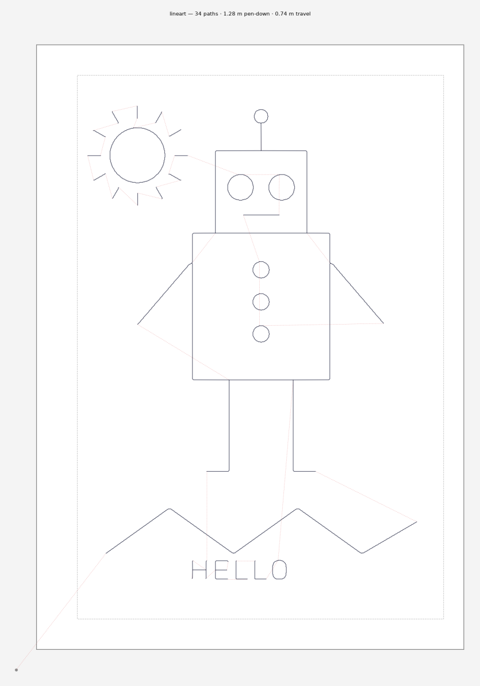
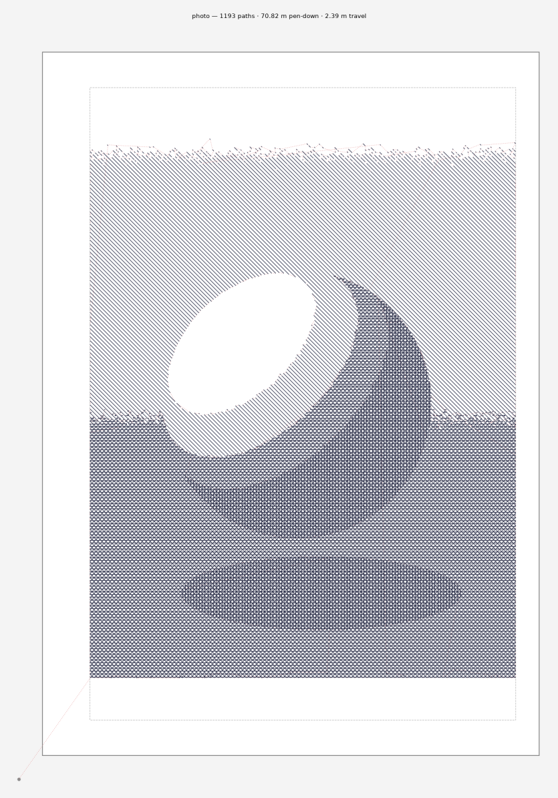
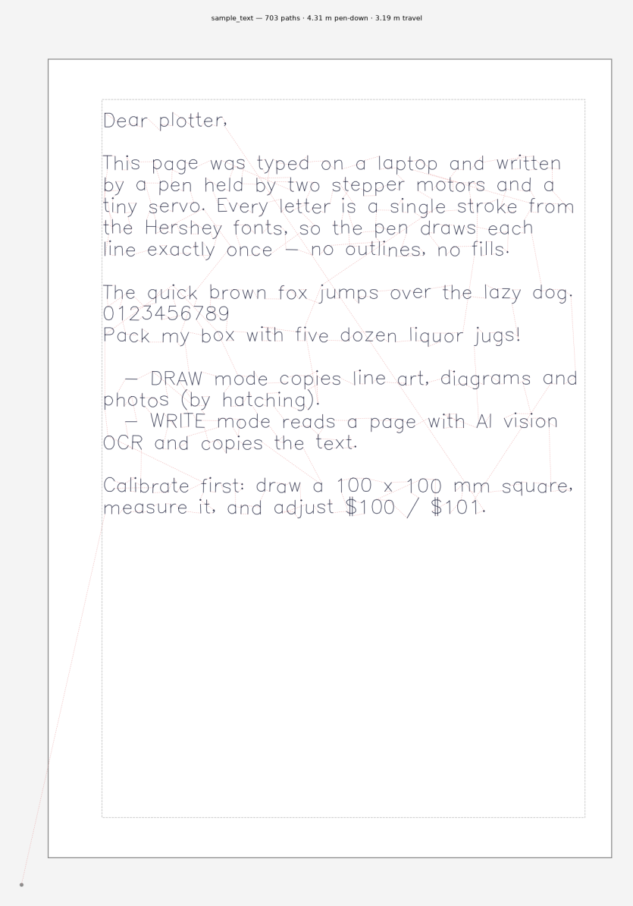

# fsck-College · ai-pen-plotter

*An automated AI assignment writer on an XY plane, built from scratch.*

A DIY **A4 handwriting and drawing machine**. You give it an image (a file or a photo from a
webcam or phone). The laptop turns it into pen strokes, generates G-code, previews it, and
streams it to an Arduino running GRBL. Two NEMA 17 steppers and an SG90 pen-lift servo then
copy it onto a sheet of A4.

| Line art (DRAW · lineart) | Photo (DRAW · hatch) | Handwriting (WRITE) |
|---|---|---|
|  |  |  |

*Previews from `make preview-sample`. Solid = pen down, dashed red = travel, dashed box = margins.*

## What it does

- **DRAW** copies an image onto A4:
  - `lineart` mode: skeletonises drawings and diagrams, so each line is drawn **once** along its centre.
  - `outline` mode: traces the edges of shapes.
  - `hatch` mode: turns photos into cross-hatching (darker areas get more hatch directions).
- **WRITE** reads the text in a photo of a page with **Claude vision OCR** (or **Tesseract**
  offline). It then writes the text on ruled lines with a single-stroke **Hershey** font, with
  word wrap, multiple pages, and optional hand-written jitter.
- **Safety first:**
  - Every job passes a validator (bed bounds, pen up before every travel, no arcs, short lines).
  - Streaming uses GRBL's character-counting protocol.
  - The software never writes GRBL `$` settings for you.
  - `--dry-run` runs everything against a built-in GRBL emulator.

```
image / photo ─► flatten page ─► DRAW: lineart | outline | hatch ─┐
                               └► WRITE: OCR (Claude → Tesseract) ─► Hershey text layout
                                                                  ▼
             simplify · join · order paths ─► G-code + validate ─► preview PNG + time
                                                                  ▼
                       stream to GRBL (char-counting) ─► Arduino Uno + CNC Shield ─► A4
```

The full design is in [docs/ARCHITECTURE.md](docs/ARCHITECTURE.md).

---

## Hardware

| Item | Spec |
|---|---|
| Mechanics | Cartesian XY gantry, 8 mm smooth rods + LM8UU bearings, GT2 6 mm belt, 20T pulleys |
| Travel | X = 230 mm, Y = 320 mm (A4 = 210 × 297 mm) |
| Motors / drivers | 2 × NEMA 17 (1.8°), 2 × A4988 at 1/16 microstepping → **80 steps/mm** |
| Pen lift | SG90 servo on GRBL spindle PWM (D11 = shield "Z+" header) |
| Controller | Arduino Uno R3 + CNC Shield V3, GRBL 1.1h, 115200 baud |
| Homing | X-min and Y-min mechanical switches (normally open) |
| Power | 12 V 5 A SMPS → shield motor input; Arduino on USB |
| Camera | USB webcam or a phone over Wi-Fi (DroidCam / IP Webcam) |

### Bill of materials (approximate prices in India, late 2026)

| Part | Qty | Approx. ₹ |
|---|---|---|
| Arduino Uno R3 (CH340 clone is fine) | 1 | 450 – 650 |
| CNC Shield V3 | 1 | 180 – 250 |
| A4988 driver with heatsink | 2 | 180 – 260 |
| NEMA 17 stepper, ~1.2–1.7 A, ~4 kg·cm | 2 | 1,500 – 2,000 |
| SG90 micro servo | 1 | 90 – 130 |
| 12 V 5 A SMPS | 1 | 400 – 600 |
| 8 mm smooth rod, ~400 mm | 4 | 720 – 1,000 |
| LM8UU linear bearing | 8 | 320 – 560 |
| GT2 6 mm belt | 2 m | 200 – 300 |
| GT2 20-tooth pulley, 5 mm bore | 2 | 160 – 240 |
| GT2 idler (or 623 bearing) | 2 – 4 | 240 – 360 |
| Mechanical endstop (NO) | 2 | 60 – 100 |
| Frame (plywood/MDF or 2020 extrusion) + printed brackets | — | 500 – 1,500 |
| Wire, jumpers, screws, zip ties | — | 200 – 300 |
| **Total (without camera)** | | **≈ ₹5,200 – 8,300** |
| USB webcam (optional; a phone with DroidCam is free) | 1 | 700 – 1,200 |

### Wiring summary

| Connection | To |
|---|---|
| X motor / Y motor | CNC Shield X / Y driver headers |
| X-min / Y-min switch (NO, signal + GND) | Shield X / Y endstop headers (D9 / D10) |
| SG90 signal (orange) | **D11 = "Z+/Z− endstop" header** signal pin |
| SG90 + / − | Shield 5 V / GND (never 12 V) |
| 12 V SMPS + / − | Shield motor power input (check polarity!) |
| Arduino | Laptop USB |
| Microstepping | All three jumpers under each driver (1/16) |

Set the A4988 current with `Vref = I × 8 × Rsense` at about 70% of the motor's rating. See
[docs/WIRING.md](docs/WIRING.md) for the diagram, the Vref table and the power rules.

---

## Software setup

Requires Python ≥ 3.10 on Windows, macOS or Linux.

```bash
git clone https://github.com/SAURABH-sys-png/fsck-College.git && cd fsck-College
python -m venv .venv
source .venv/bin/activate              # Windows: .venv\Scripts\activate
pip install -e . -r requirements-dev.txt
pre-commit install                     # optional: lint + type-check on commit
cp .env.example .env                   # then fill in ANTHROPIC_API_KEY and AI_MODEL for AI OCR
plotter --help
```

**Tesseract** is the offline OCR fallback, used when no API key is set:

- Ubuntu/Debian: `sudo apt install tesseract-ocr`
- macOS: `brew install tesseract`
- Windows: the [UB Mannheim installer](https://github.com/UB-Mannheim/tesseract/wiki). Add it to `PATH`.

**AI OCR:** put your Anthropic key in `.env` as `ANTHROPIC_API_KEY`, and set `AI_MODEL` to the
Claude model to use (e.g. `claude-opus-5-5`). The code never hardcodes either value. `.env`
is git-ignored.

**GUI:** `pip install -e ".[gui]"`, then `make gui` (or `streamlit run app/streamlit_app.py`).

**Firmware:** flash GRBL 1.1 with servo PWM by following
[firmware/GRBL_SETUP.md](firmware/GRBL_SETUP.md).

---

## Quick start: your first job (dry run, no hardware)

```bash
plotter draw samples/lineart.png --mode lineart --out output/robot.gcode --preview output/robot.png
plotter preview output/robot.gcode --out output/robot_check.png      # time + distances
plotter send output/robot.gcode --dry-run                             # streams to the emulator
```

Handwriting:

```bash
plotter write samples/sample_text.txt --out output/letter.gcode --preview output/letter.png
plotter copy-page samples/page_photo.jpg --out output/copy.gcode --preview output/copy.png
```

Long text produces `letter_p1.gcode`, `letter_p2.gcode`, and so on, one file per A4 page.

On the real machine, **after calibrating**:

```bash
plotter home
plotter send output/robot.gcode            # shows the stop hint and asks to confirm
```

### All commands

```
plotter capture --out page.jpg                         # webcam / phone photo
plotter flatten page.jpg --out flat.png                # find the sheet, warp to A4
plotter draw IMAGE --mode lineart|outline|hatch --out job.gcode [--preview p.png] [--flatten]
plotter ocr IMAGE [--engine auto|ai|tesseract] --out text.txt
plotter write TEXT_FILE --out job.gcode [--preview p.png]
plotter copy-page IMAGE --out job.gcode [--preview p.png]
plotter preview job.gcode --out preview.png
plotter send job.gcode [--port auto] [--dry-run] [--yes]
plotter home | unlock | status | settings              # each accepts --dry-run
plotter pen up|down
plotter jog --x 10 --y 0 [--feed 1000]
```

Every command takes `--config` (default `config/machine.yaml`). All tunables live in that file:
bed, page origin, margins, feeds, pen commands, vision, text and AI settings.

---

## Calibration (summary)

1. `stepper_test.ino`: check that +X moves right and +Y moves away from you.
2. Flash GRBL, then apply [`firmware/grbl_settings.txt`](firmware/grbl_settings.txt) **by hand**.
3. `plotter home`.
4. Plot `samples/calibration_square.gcode` and measure. Set `$100 = 80 × 100 / measured_x`
   (same for `$101` with Y). Equal diagonals mean the frame is square.
5. Find the pen up/down `S` values with `servo_test.ino`, then set `pen.*` in the config.
6. Plot `samples/origin_mark.gcode` and tape the sheet's bottom-left corner onto the mark.

The full procedure is in [docs/CALIBRATION.md](docs/CALIBRATION.md).

## Safety and stopping

- **Physical stop:** press the Arduino **reset** button or **unplug the 12 V supply**.
- **Software stop:** Ctrl+C during `plotter send` sends feed hold `!` then soft reset `0x18`.
  The GUI has Pause / Resume / Abort buttons.
- `send` validates the job again before streaming, so an out-of-bounds job never reaches the
  machine.
- After an abort or an alarm, run `plotter home` (or `plotter unlock` if you are sure of the
  position).

Problems? See [docs/TROUBLESHOOTING.md](docs/TROUBLESHOOTING.md).

---

## Development

```bash
make test        # pytest + coverage (≥ 85% gate on paths, gcode, text_layout, grbl, config)
make lint        # ruff check + ruff format --check
make typecheck   # mypy --strict on plotter/
make check       # all of the above
make samples     # regenerate synthetic sample inputs
make preview-sample
```

- Tests need **no hardware, camera or network**. They use synthetic images, the `FakeGrbl`
  emulator and a mocked Claude client.
- CI runs on Ubuntu and Windows with Python 3.10–3.12.
- Conventions (coordinate frames, module rules, safety) are in [CLAUDE.md](CLAUDE.md).
- Decisions made while building this are recorded in [docs/ASSUMPTIONS.md](docs/ASSUMPTIONS.md).

```
plotter/      config · types · errors · camera · perspective · vision · ocr · text_layout
              paths · gcode · preview · grbl · grbl_codes · fake_grbl · pipeline · cli
app/          Streamlit GUI
firmware/     GRBL setup guide, settings, Arduino test sketches
docs/         architecture, wiring, calibration, troubleshooting, assumptions
samples/      synthetic inputs + calibration G-code
tests/        pytest suite (hardware-free)
```
