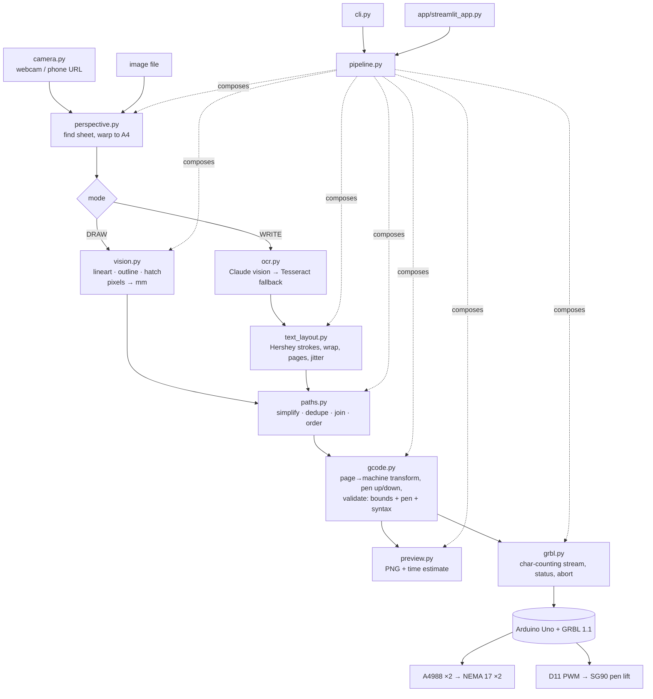
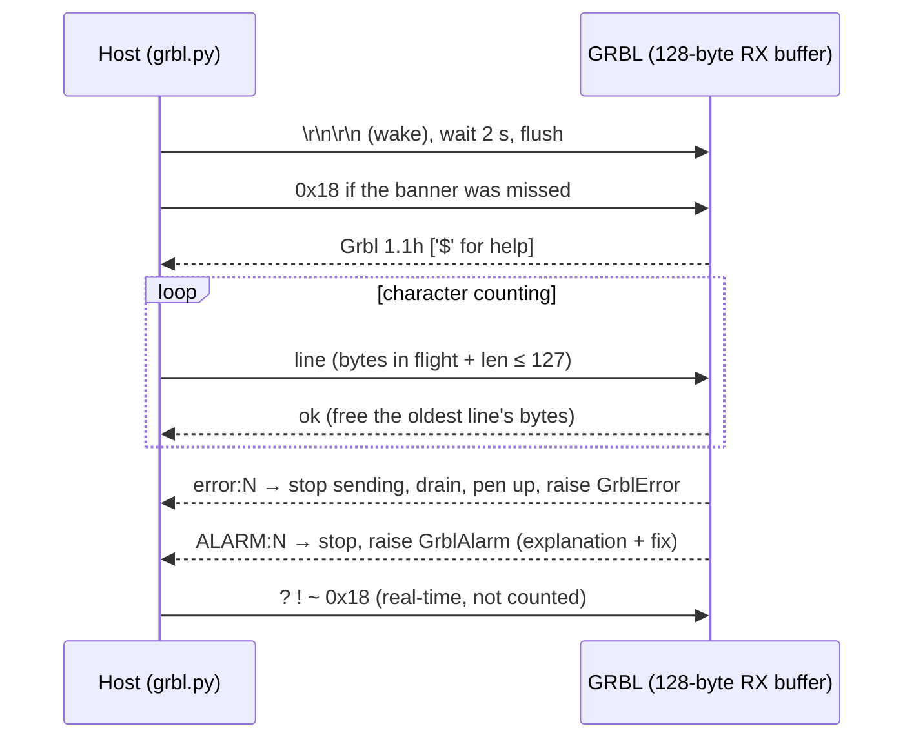

# Architecture

Everything except motor control runs on the laptop in Python. The Arduino only executes G-code.



## Rules

- **Pure stages.** Every stage maps input to output with no hidden state, so it can be tested
  without hardware. `Config` is a frozen dataclass passed explicitly; there are no globals.
- **One owner per side effect.** Only `camera.py` opens a camera, only `ocr.py` uses the
  network, only `grbl.py` touches a serial port, and only `gcode.py` knows the machine frame.
- **Thin interfaces.** `cli.py` and the Streamlit app call `pipeline.py` and nothing else that
  matters.

## Units and frames

| Frame | Origin | Axes | Used in |
|---|---|---|---|
| pixel | image top-left | +x right, +y down | `vision.py`, `perspective.py` only |
| **page** (mm) | top-left corner of the A4 sheet | +x right, +y **down** | all drawing and text logic |
| **machine** (mm) | homed position, front-left | +X right, +Y **away** from you | G-code only |

The sheet lies in portrait with its bottom-left corner at `machine.page_origin_mm`. The **only**
y-flip is in `gcode.page_to_machine`, and it is unit-tested:

```
X = ox + x
Y = oy + (297 − y)
```

Geometry is `Path = np.ndarray (N, 2) float64` in page-mm, and `Drawing = list[Path]`.

## Path optimisation (`paths.py`)

1. **simplify**: Ramer–Douglas–Peucker (iterative, distance to segment, vectorised).
2. **dedupe_points / filter_short**: merge sub-0.2 mm segments and drop dots.
3. **join_paths**: a KD-tree over endpoints merges strokes that touch (reversing where needed),
   so a skeleton broken at junctions becomes long continuous strokes.
4. **order_paths**: greedy nearest-neighbour from the pen's home position, allowing reversal.
   An optional 2-opt pass follows (≈20% less travel on random strokes), and the result is
   never worse than the input order.

## Vision (`vision.py`)

- **lineart**: blur → adaptive threshold → 2×2 open → `skeletonize` → graph tracing.
  - Redundant L-corner pixels are removed first, so they don't fake junctions.
  - Walks go from node to node along degree-2 pixels and are extended to the centroid of the
    junction cluster they touch, so strokes meet exactly.
  - Short spurs with a free end are pruned.
- **outline**: Canny (Otsu-derived thresholds) → `findContours(RETR_LIST, CHAIN_APPROX_NONE)`.
  Pixels already drawn by an earlier contour are skipped, so both sides of a 1-px edge are not
  drawn twice.
- **hatch**: normalise → quantise into `levels`. Level *k* gets
  `round(len(angles) × (L−1−k)/(L−1))` hatch directions. Lines are sampled in mm, looked up in
  the level mask, and runs inside the mask become segments.

## G-code (`gcode.py`)

```
G21 G90 G17 G94 · pen up · G4 P0.15
per path:  G0 X Y · pen down · G4 · G1 X Y F3000 · G1 … · pen up · G4
footer:    pen up · G4 · G0 X0 Y0 · M5
```

`validate()` replays the job and raises `OutOfBoundsError` for any X/Y outside the bed. It
raises `GcodeError` for:

- motion before the pen state is known, or `G0` with the pen down;
- a job that ends with the pen down;
- arcs, `G91`, `G20`, Z words, or unknown spindle commands;
- `$` commands inside a job;
- lines of 70 characters or more.

`to_gcode` always calls it, and `pipeline.send_job` calls it again before streaming.

## Streaming (`grbl.py`)



- `FakeGrbl` (`fake_grbl.py`) emulates the banner, the 128-byte buffer (it **asserts** ≤ 127
  unprocessed bytes), `ok`/`error`/`ALARM` injection and status reports.
- The tests and `send --dry-run` stream through it, so the dry run exercises the real protocol.
- `Grbl.command()` refuses `$N=…` setting writes.

## Text (`text_layout.py`, `ocr.py`)

- **Layout:** Hershey `futural` from the `Hershey-Fonts` package, scaled so the cap height
  equals `text.size_mm`.
  - Word wrap uses measured advance widths; leading indentation and blank lines are kept.
  - Over-long words are hyphenated, and lines that overflow start a new page.
  - The worst case of the seeded jitter (scale, rotation, baseline) is reserved inside the
    margins, which is why the "text never crosses the margins" test holds with jitter on.
- **OCR:** an `anthropic` SDK `messages.create` call with a base64 JPEG block plus the
  transcription prompt. The model name and key come from the env vars named in `config.ai`.
  - The SDK retries 429, 5xx and connection errors with exponential backoff
    (`ai.max_retries`), and each request times out after `ai.timeout_s`.
  - Refusals and API errors become `OcrError`. In `auto` mode those fall back to Tesseract
    (grayscale + Otsu).
